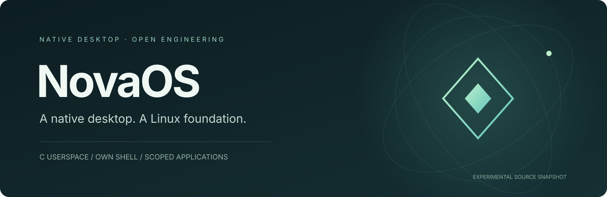

<p align="center"></p>

<p align="center"><strong>An independent desktop and userspace project on the Linux kernel.</strong><br>Native C compositor · own shell and service manager · scoped application integration</p>

<p align="center">
  <a href="LICENSE"></a>
  
  
  <a href="https://github.com/kaandevs-ops/NovaOS/actions/workflows/components.yml"></a>
</p>

<p align="center"><a href="README.tr.md">Türkçe</a> · <a href="#the-project">Project</a> · <a href="#explore-the-source">Source</a> · <a href="#quick-start">Build checks</a> · <a href="docs/ARCHITECTURE.md">Architecture</a> · <a href="docs/ROADMAP.md">Roadmap</a></p>

> **Development source, with explicit boundaries.** This repository is a curated, classroom-free source snapshot. It is not a bootable VM download or a production-ready operating system. The Linux kernel and integrated upstream programs are not authored by NovaOS. The banner above is original identity artwork, not a screenshot.

## The project

NovaOS explores a desktop that feels coherent across its shell, windows, file manager, terminal and application lifecycle. The project develops its own native C desktop components, `novad` PID 1/service integration and rootfs/initramfs build work on top of Linux. It is not an Ubuntu theme or a renamed GNOME/KDE installation.

The longer-term direction is a refined, responsive desktop with practical applications, extensibility and scoped permissions. That is the engineering goal, not a claim that every Linux application, game or device already works.

## Explore the source

| Area | What is here |
| --- | --- |
| **Desktop** | Native compositor, shell, dock, focus/window management and shared UI code |
| **Files** | Directory navigation, filtering/sorting and bounded guest adapters |
| **Terminal** | Session/process support and Turkish keyboard handling |
| **Applications** | Catalog, manifests, software/package lifecycle and browser compatibility integration |
| **Platform** | Service/principal checks, descriptor transfer, sandbox and boot integration sources |
| **Verification** | Host tests, source hygiene audit and x86_64/AArch64 component build checks |

Start with [the source map and architecture](docs/ARCHITECTURE.md). Directories retain historical R-number names where tests and includes depend on them; they are not a promise of separate supported releases.

## Quick start

On Linux or WSL, install Bash, Python 3, GCC, Clang and lld; then:

```sh
git clone https://github.com/kaandevs-ops/NovaOS.git
cd NovaOS
python3 scripts/audit-public.py
bash scripts/check-public.sh
```

This checks selected native components; it does **not** build or launch a complete OS. See [prerequisites and exact scope](docs/BUILDING.md).

## Verification and limits

The public check covers the keyboard test, terminal-session build, Python syntax, compositor/shell cross-target objects, authenticated theme host tests and Files-view host tests. Sanitizers are enabled for the theme/Files tests. Recorded results and scope are in [VALIDATION.md](docs/VALIDATION.md).

Full public rootfs assembly, signed guest boot, physical-hardware acceptance, complete Unicode, GPU acceleration and production security acceptance remain **pending** for this curated snapshot. Historical private guest results are not transferred to a modified public tree as new PASS results.

## What is intentionally absent?

Classroom exercises, slides, student documents, Windows remote-control tools/configuration, personal test evidence, private keys, user data, VM disks and firmware/TPM state are excluded. An inspected synthetic two-page PDF remains only as a renderer test fixture. The inherited undocumented photograph and legacy raster were replaced by neutral source placeholders; the public tree does not reproduce the old VM wallpaper exactly.

There is no general internet app store endpoint or unrestricted Ubuntu package compatibility claim. A clean, reproducible and license-complete bootable release is a separate milestone in [the roadmap](docs/ROADMAP.md).

## License and attribution

Original NovaOS code/documentation: **Apache-2.0**, matching the author's other repositories. Explicit per-file and upstream licenses take precedence. In particular, the MuPDF-linked worker is **AGPL-3.0-or-later**. Read [NOTICE](NOTICE), [licensing boundaries](docs/LICENSING.md) and [third-party notices](THIRD_PARTY_NOTICES.md).

## Contributing

Small, reproducible improvements are welcome. Explain the behavior, run the checks and distinguish host evidence from real guest observations. See [CONTRIBUTING.md](CONTRIBUTING.md) and [SECURITY.md](SECURITY.md).

Created by [Kaan Tekin / kaandevs-ops](https://github.com/kaandevs-ops).
