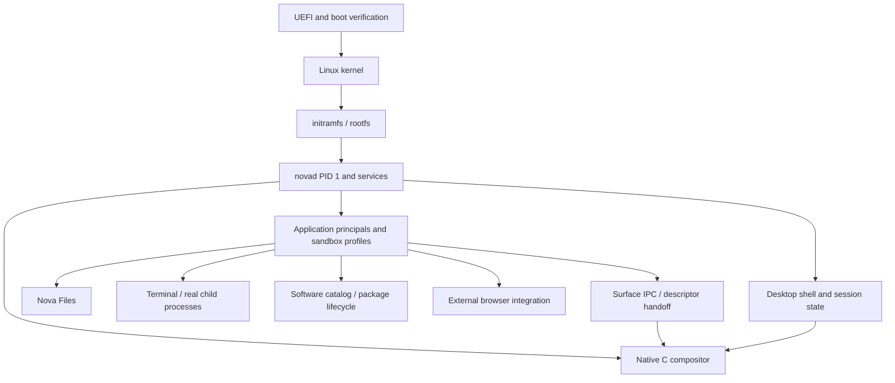

# Architecture

NovaOS uses the Linux kernel and develops its own boot/rootfs integration and userspace.

| Directory | Role |
| --- | --- |
| `src/services` | compositor, shell and system services |
| `src/runtime` | freestanding runtime, IPC, input, font and UI support |
| `src/terminal` | terminal session and process integration |
| `src/pdf` | PDF client and isolated worker protocol |
| `src/compat` | external graphical program compatibility support |
| `files/src` | Files engine and guest adapters |
| `configs` | application/service manifests and configuration |
| `scripts` | build references and supported public component check |
| `tests`, `tools` | host tests and development utilities |
| `third_party` | attributed upstream source and patches |

Principal/generation checks, scoped FD handoff, memfd/surface validation and per-application sandbox policies are present in the sources. Tests must distinguish real kernel/process behavior from mocked peers. Source presence is not guest acceptance.

Compatibility is constrained by the application catalog, ABI/runtime libraries, graphics bridge, device support and permissions. Arbitrary Ubuntu packages, Windows games, GPU acceleration and full Unicode are not accepted capabilities of this publication.
